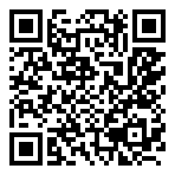

# [2026-2학기] UNIST - (우건민길성) 목격자 W.I.T.
### Watch · Inform · Train
**당신의 자세를 목격하고, 바른 습관을 만듭니다.**

목격자(W.I.T.)는 카메라로 사용자의 자세 변화를 관찰하고, 자세 조정과 휴식을 안내하는 **온디바이스 AI 자세 코칭 프로젝트**입니다.

노트북 웹캠으로 간편하게 시작하고, 향후 스마트폰 환경으로 확장하는 것을 목표로 합니다. 

영상 분석은 사용자 기기에서 수행하며, 개인별 기준 자세와 비교해 변화를 알려줍니다.

## 0.웹에서 바로 실행

## https://insonmia0126-lovable.github.io/WIT-posture-Coach/ ##



-Chrome에서 위 주소를 연 뒤 웹캠 시작을 누르고 카메라 권한을 허용하세요. 

-또는  QR코드를 카메라로 찍어서 웹사이트와 바로 연결하세요

-HTTPS라서 별도 서버 없이 브라우저에서 동작합니다. 

-같은 주소로 약 30명이 동시에 열어도 됩니다. 자세 계산은 각자 노트북에서 하고, 공개 사이트는 앱 파일만 나눠 줍니다. 사람마다 웹캠이 따로 필요합니다. 모델 파일을 잠시 못 받으면 자동으로 다시 받고, 한 번 받은 파일은 그 브라우저에 저장합니다.

-처음 열면 `WIT-`로 시작하는 개인 아이디가 부여됩니다. 그 아이디의 실측 이력은 그 브라우저에만 남고, 시작 화면의 이력에서 보고 CSV로 받을 수 있습니다.

-v1.0의 업무용 기본 범위(고개·어깨 14°/복귀 9°, 상체 0.22/복귀 0.14)와 화면 구성을 유지합니다. 기준 등록에는 안정적으로 인식된 7초를 누적합니다. 탭 전환·최소화 중에도 측정 유지를 시도하며, 설정에서 자동 일시정지를 선택할 수 있습니다. 브라우저의 절전·카메라 제한에 따라 백그라운드 추론은 중단될 수 있습니다.

-한 번 측정을 끝낸 뒤 같은 화면에서 다시 웹캠을 시작할 수 있습니다. 카메라가 없으면 데모 시작을 사용합니다.

### 추가·개선한 기능

| 기능 | 개선 내용 |
|---|---|
| 카메라 위치별 분석 | 사용자 기준 정면·왼쪽 대각·오른쪽 대각 선택. 위치를 바꾸면 이전 기준을 해제하고 재등록 안내 |
| 자세 허용 범위 선택 | 기존(v0.2)·여유·업무(기본)·넉넉 프리셋과 세부 임계값 조절 |
| 기준 자세 등록 안정화 | 안정적으로 인식된 시간만 누적. 짧은 흔들림에는 진행률을 유지하고, 다른 자세가 지속될 때 새 기준 수집 |
| 인식값 흔들림 보정 | 순간적인 좌표·각도 오차를 줄이는 필터 제공(끄기·기본·강하게) |
| 측정 중단·복귀 설정 | 기본은 백그라운드 측정 유지. 선택 시 탭을 벗어나면 일시정지하고 복귀 시 자동 재개. 수동 일시정지는 유지 |
| 웹캠·추론 재시작 보완 | 세션별 시간 초기화, 늦게 열린 카메라 해제, 인식기 오류 복구 및 화면 이동 후 영상 재연결 |
| 측정 기록·설정 저장 | 실제 측정과 일시정지 시간을 구분하고 CSV에 `paused_s` 추가. 카메라 위치·허용 범위·필터·탭 동작 설정 저장 |

**카메라 위치 설정:** 왼쪽·오른쪽은 화면 속 좌우가 아닌 사용자의 실제 카메라 위치입니다. 카메라를 바라보려고 몸을 돌리지 말고 평소 업무 화면을 보며 기준을 등록하세요. 정면은 양쪽 눈·어깨를, 대각 모드는 카메라 쪽 눈·귀와 양쪽 어깨를 사용합니다. 대각 모드는 2D 상대 변화 비교용이며, 완전한 옆모습이나 실제 목 전방 각도 측정을 지원하지 않습니다.

**기준 등록:** 얼굴·어깨가 가려진 시간과 긴 프레임 공백은 등록 시간에 포함하지 않습니다. 짧은 흔들림이 생겨도 누적 시간을 모두 지우지 않으므로, 실제 완료까지 걸리는 시간은 기본 7초보다 길 수 있습니다.

**탭 전환:** 설정의 `탭을 벗어나면 일시정지`는 기본적으로 꺼져 있습니다. 켜면 카메라 연결은 유지하되 분석을 쉬며, `탭 복귀 시 자동 재개`를 선택할 수 있습니다. 측정 유지 모드에서도 새 프레임 없이 멈춘 시간을 유효한 자세 인식 시간으로 채우지 않습니다. 연속 측정이 중요할 때는 측정 화면을 작업 창 옆에 보이게 두세요.

### 로컬 실행 및 검증

Node.js `^20.19.0` 또는 `>=22.12.0`과 Git을 설치한 뒤 실행합니다.

```bash
git clone https://github.com/insonmia0126-lovable/WIT-posture-Coach.git
cd WIT-posture-Coach
npm --prefix app ci
npm --prefix app run dev -- --host 127.0.0.1
```

브라우저에서 `http://localhost:43124`를 열고 카메라 권한을 허용하세요. VS Code에서도 프로젝트 폴더를 열어 터미널에서 같은 명령을 실행할 수 있습니다. 이미 복제했다면 복제 단계는 생략합니다.

```bash
npm --prefix app test
npm --prefix app run build
npm --prefix app run lint -- src
```

자동 테스트는 카메라 위치별 지표, 기준 등록·일시정지, 인식값 보정, 설정 저장과 자세 판정 흐름을 확인합니다. 실제 사람·조명·카메라 위치에서의 인식 품질은 별도 시연으로 확인해야 합니다.

---

## 1. 프로젝트 소개

PC나 스마트폰을 사용하다 보면 자신도 모르게 고개를 숙이거나 화면 쪽으로 몸을 기울이게 됩니다. 

목격자는 이러한 변화를 사용자가 알아차리고 스스로 자세를 조정하도록 돕습니다.

| 이름 | 의미 | 핵심 역할 |
|---|---|---|
| **Watch** | 관찰하다 | 카메라로 머리·어깨 위치와 자세 변화 관찰 |
| **Inform** | 알려주다 | 기준 자세에서 벗어난 상태가 지속되면 안내 |
| **Train** | 습관을 만들다 | 자세 조정과 주기적인 휴식 실천 지원 |

**<ins><strong>목격자는 질환을 진단하거나 치료하는 앱이 아닙니다.</strong></ins>**
개인 기준 대비 자세 변화와 사용 습관을 점검하는 보조 도구입니다.

## 2. 첫 번째 개발 목표

**중간발표에서 노트북 웹캠으로 직접 시연할 수 있는 작동 가능한 시제품(MVP) 구현**

첫 버전에서는 기능 수보다 **기준 등록 → 변화 감지 → 알림 → 자세 복귀** 흐름이 안정적으로 작동하는 데 집중합니다.

### 기본 사용 흐름

1. 웹앱을 실행하고 카메라 사용을 허용합니다.
2. 화면 안내에 따라 얼굴과 양쪽 어깨가 보이도록 앉습니다.
3. 안정적으로 인식된 시간을 기본 7초 누적해 개인 기준 자세를 등록합니다.
4. 등록된 기준과 현재 자세의 차이를 확인합니다.
5. 기준 이탈이 일정 시간 지속되면 자세 조정 안내를 받습니다.
6. 사용을 마친 뒤 점검 시간과 알림 기록을 확인합니다.

## 3. 주요 개발 범위

아래 항목은 **구현 목표**이며, 완료 여부는 GitHub Issues와 PR에서 관리합니다.

| 기능 | 구현 목표 | 우선순위 |
|---|---|---|
| 웹캠 연결 | 카메라 권한 요청·미리보기·종료 | 필수 |
| 촬영 상태 확인 | 얼굴·어깨 인식 여부 확인 및 측정 불가 안내 | 필수 |
| 개인 기준 등록 | 일정 시간의 유효한 인식 결과로 기준값 생성 | 필수 |
| 자세 변화 감지 | 머리 기울기·어깨 정렬·상체 위치 등 기준 대비 변화 비교 | 필수 |
| 지속 이탈 알림 | 짧은 움직임을 제외하고 지속되는 변화에 안내 | 필수 |
| 기준 재설정 | 카메라 위치나 착석 환경 변경 시 재등록 | 필수 |
| 눈 휴식 타이머 | 일정 사용시간 후 휴식 안내 | 추가 |
| 점검 기록 | 점검 시간·기준 이탈 시간·알림 횟수 요약 | 추가 |

### 첫 버전에서 제외하는 기능

- 정면 영상만으로 정확한 목 전방 각도 측정
- 카메라 영상만으로 눈 피로도나 실제 조도 확정
- 모니터 높이·각도의 자동 측정 및 물리적 제어
- 스마트폰의 다른 앱을 사용하는 동안 상시 카메라 감시
- 회원가입·클라우드 영상 저장·외부 생성형 AI 연동

## 4. 자세 판단 원칙

목격자는 **‘정상 자세 판정’보다 ‘개인 기준 대비 변화 감지’**에 집중합니다.

- **기준 유지:** 등록된 기준과의 차이가 설정 범위 이내
- **자세 조정 권장:** 기준 이탈이 설정 시간 이상 지속
- **측정 불가:** 얼굴·어깨 미검출 또는 인식 신뢰도 부족
- **일시정지:** 사용자가 일시정지를 누르거나, 선택한 탭 이탈 일시정지 설정이 적용된 상태. 일시정지 시간은 실제 측정 시간에서 제외합니다.

사용자가 잘못된 자세를 기준으로 등록할 수 있으므로, **‘기준 유지’를 ‘의학적으로 올바른 자세’로 표시하지 않습니다.**

### 알림 로직 초안

- 순간적인 움직임은 알림에서 제외합니다.
- 기준 이탈이 일정 시간 지속될 때 안내합니다.
- 알림 후에는 대기시간을 두어 반복 알림을 줄입니다.
- 측정 불가 시간은 기준 유지 또는 기준 이탈 시간에 포함하지 않습니다.
- 카메라 위치가 바뀌면 기준 자세를 다시 등록하도록 안내합니다.

> 현재(v1.0) 기본값: 기준 등록 7초, 이탈 지속 20초, 반복 알림 대기 3분, 복귀 확인 3초.  
> 허용 범위는 고개·어깨 14°(복귀 9°), 상체 보조 0.22(복귀 0.14)입니다. v0.2는 8°·5°·0.12·0.08이었습니다.  
> 기본은 탭 전환·최소화 중에도 측정을 시도하며, 설정에서 일시정지 및 복귀 시 자동 재개를 선택할 수 있습니다. 브라우저 제한으로 백그라운드 추론이 멈출 수 있습니다.
> 위 수치는 의료 기준이 아니며, 실제 시연과 사용성 테스트를 통해 조정합니다. 시연용으로 시간을 단축할 경우 화면에 ‘시연 모드’를 표시합니다.

## 5. 기술 구성

v1.0에서 쓰는 구성입니다. v0.1 Python 프로토타입은 태그 `v0.1`에 남아 있습니다.

| 구분 | 구성 | 역할 |
|---|---|---|
| 프런트엔드 | React + TypeScript | 화면 및 사용자 흐름 구현 |
| 카메라 입력 | 브라우저 카메라 API | 웹캠 영상 입력 |
| AI 추론 | MediaPipe Pose Landmarker | 신체 주요 지점 추출 |
| 자세 판정 | 개인 기준 대비 규칙 기반 로직 | 변화량·지속시간에 따른 상태 결정 |
| 로컬 저장 | 브라우저 내부 저장소 | 개인 아이디(`WIT-`)와 그 아이디의 실측 이력. 다른 기기로 따라가지 않음 |
| 개발·협업 | Cursor + GitHub | 개발, 버전 관리, 코드 검토 |

**AI 모델은 신체 주요 지점을 추출하고, 앱의 판정 로직은 그 결과를 기준값과 비교합니다.** 자세 안내 문구는 사전에 정의한 규칙으로 제공하는 것을 기본으로 합니다.

## 6. 개인정보 및 온디바이스 설계

- 카메라 영상은 사용자 기기에서 분석하도록 구현합니다.
- 원본 영상과 얼굴 이미지는 기본적으로 저장하거나 서버로 전송하지 않습니다.
- 저장 정보는 개인 아이디, 표시 이름, 실측 요약 및 분석 설정으로 최소화합니다. 영상은 저장하지 않습니다.
- 사용자가 카메라와 분석을 중단할 수 있도록 합니다.
- 카메라 종료 시 영상 스트림도 해제합니다.
- 외부 통신 여부는 브라우저 네트워크 기록으로 검증합니다.

**온디바이스 추론과 완전한 오프라인 실행은 구분합니다.** 자세 모델과 WASM은 저장소 `app/public/`과 공개 사이트에 포함되어 있고, 분석 중 프레임은 서버로 보내지 않습니다. 네트워크를 끈 뒤의 재실행은 아직 검증하지 않았습니다.

## 7. 협업 방식

### 작업 원칙

1. **Issue 등록:** 개발할 기능이나 오류, 완료 기준 작성
2. **브랜치 생성:** 작업별로 독립된 브랜치 사용
3. **개발 및 확인:** 변경 범위를 작게 유지하고 직접 실행
4. **PR 작성:** 변경 내용·확인 방법·남은 문제 공유
5. **검토 및 병합:** 팀원 검토 후 `main`에 반영

### 브랜치 예시

| 브랜치 | 작업 예시 |
|---|---|
| `main` | 실행 가능한 기준 버전 |
| `feat/camera` | 웹캠 연결 및 권한 처리 |
| `feat/calibration` | 개인 기준 자세 등록 |
| `feat/posture-alert` | 자세 변화 판정 및 알림 |
| `feat/session-summary` | 점검 기록과 요약 |
| `fix/camera-permission` | 카메라 권한 오류 수정 |
| `docs/readme` | 문서 보완 |

### AI와 함께 개발할 때

- 작업 전 최신 코드를 반영하고 수정 범위를 확인합니다.
- AI에게 **담당 기능·수정 파일·완료 조건**을 구체적으로 전달합니다.
- 요청하지 않은 화면 개편이나 의존성 변경은 별도 작업으로 분리합니다.
- AI가 작성한 코드도 직접 실행한 뒤 PR을 올립니다.
- 같은 파일을 동시에 수정해야 한다면 팀원과 먼저 조율합니다.
- API 키·개인정보·촬영 영상은 저장소에 올리지 않습니다.

## 8. 중간발표 시연 완료 기준

- [ ] 카메라 권한 허용 후 영상 표시
- [ ] 권한 거부·카메라 미연결 시 안내 표시
- [ ] 얼굴·어깨가 보이지 않을 때 측정 불가 처리
- [ ] 개인 기준 자세 등록 및 재등록
- [ ] 기준 대비 자세 변화에 따른 상태 변경
- [ ] 설정 시간 이상 이탈 시 알림 발생
- [ ] 기준 자세 복귀 시 상태 회복
- [ ] 반복 알림 제한 작동
- [ ] 분석 중단·카메라 종료 작동
- [ ] 원본 영상의 외부 전송 여부 검증

시연 결과에는 사용 기기·브라우저·조명·카메라 위치를 함께 기록합니다. 성공 장면뿐 아니라 미검출과 오작동 조건도 공유합니다.

## 9. 향후 확장

- 스마트폰 거치형 PC 자세 점검
- 촬영 환경별 알림 민감도 사용성 검증
- 휴식 및 사용 습관 기록
- 지원 기기의 조도 센서 연동
- 대각 촬영 분석의 실사용 검증 및 측면 촬영 지원 확대
- 다양한 촬영 환경에서의 인식 안정성 개선

---

버전 이력은 [`version/`](./version/) 폴더에서 봅니다. (`v0.1`부터 `v1.0`)  
결과에서 배운 점은 [`learning/`](./learning/)에 버전을 붙여 남깁니다.

---

**목격자 W.I.T. — 자세의 변화를 알아차리는 순간, 습관의 변화가 시작됩니다.**
